<div align="center">

<picture>
  <source media="(prefers-color-scheme: dark)" srcset="assets/hero-dark.svg">
  
</picture>

<a href="https://www.linkedin.com/in/frank-f%C3%A9lix-rodr%C3%ADguez-22ab42114/"></a>
<a href="https://frank-felix-portfolio.vercel.app"></a>
<a href="https://github.com/sponsors/FrankLord27"></a>

</div>

## Sobre mí

Soy **Frank Félix Rodríguez Canario**, desarrollador fullstack y técnico de IT en República Dominicana.

- Construyo **productos SaaS** y **sistemas para colegios**, de la base de datos a la pantalla.
- Trabajo con **NestJS, Next.js, TypeScript, Prisma y PostgreSQL**, con seguridad y rendimiento desde el día uno.
- Uso la IA como herramienta de trabajo diaria y armé **[ai-lordkit](https://github.com/FrankLord27/ai-lordkit)** para que cualquiera tenga Claude Code bien configurado en un comando.

## Proyecto destacado

<a href="https://github.com/FrankLord27/ai-lordkit">
  <picture>
    <source media="(prefers-color-scheme: dark)" srcset="assets/featured-dark.svg">
    
  </picture>
</a>

```bash
curl -fsSL https://raw.githubusercontent.com/FrankLord27/ai-lordkit/main/get.sh | bash
```

## Stack

<picture>
  <source media="(prefers-color-scheme: dark)" srcset="assets/stack-dark.svg">
  
</picture>

## Actividad

<picture>
  <source media="(prefers-color-scheme: dark)" srcset="https://raw.githubusercontent.com/FrankLord27/FrankLord27/output/snake-dark.svg">
  
</picture>

## Apoya mi trabajo

<div align="center">

<a href="https://github.com/sponsors/FrankLord27"></a>

<br><br>

<picture>
  <source media="(prefers-color-scheme: dark)" srcset="assets/footer-dark.svg">
  
</picture>

</div>
